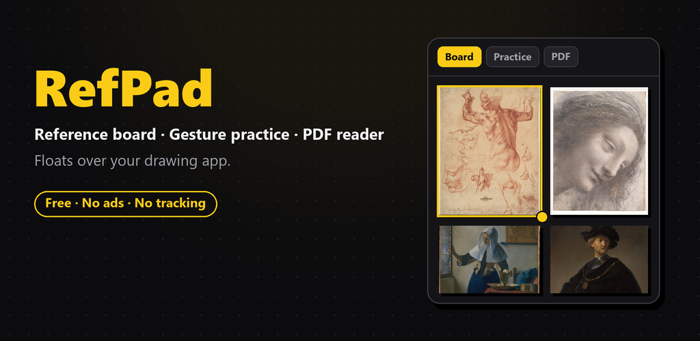
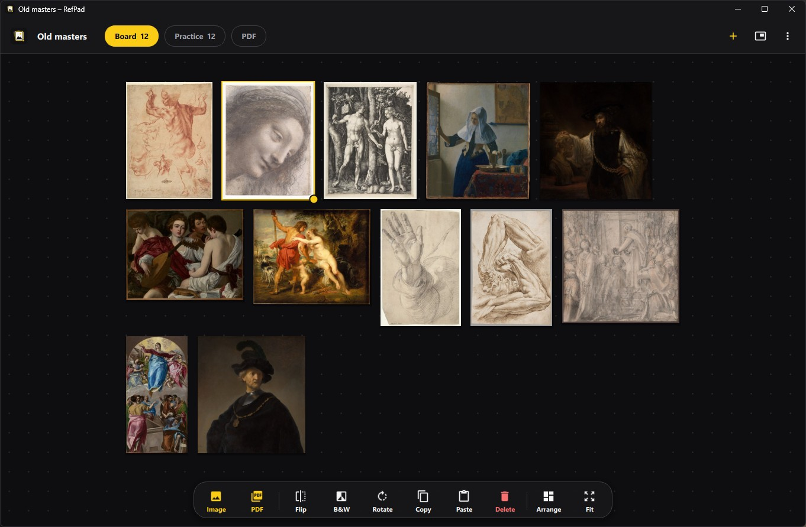
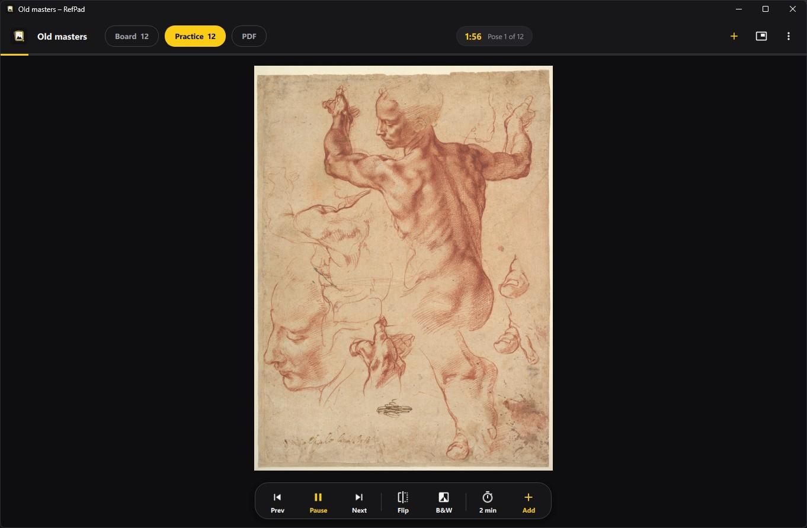
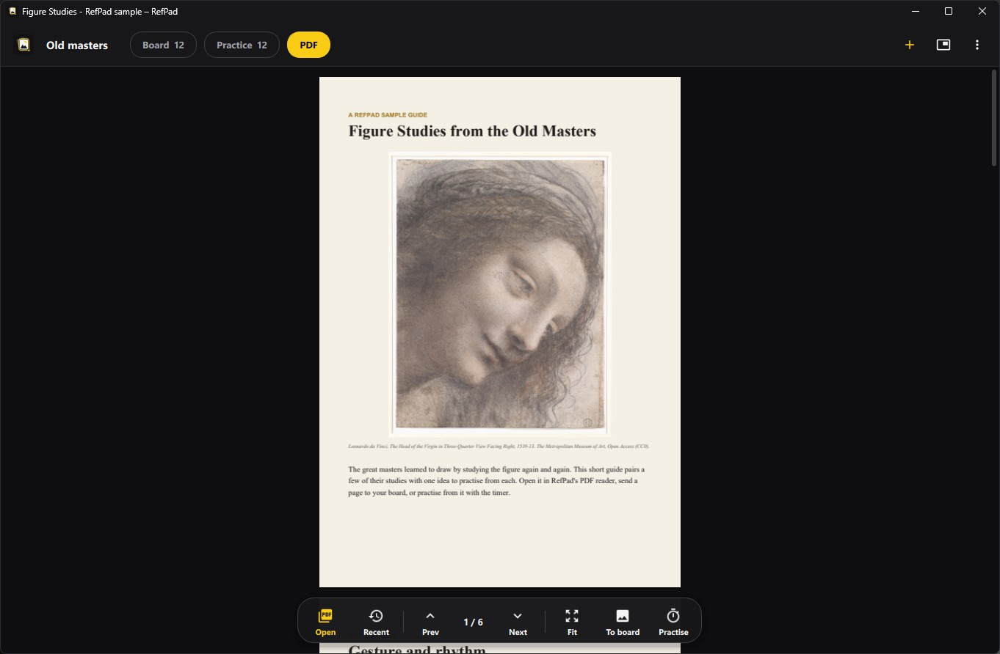
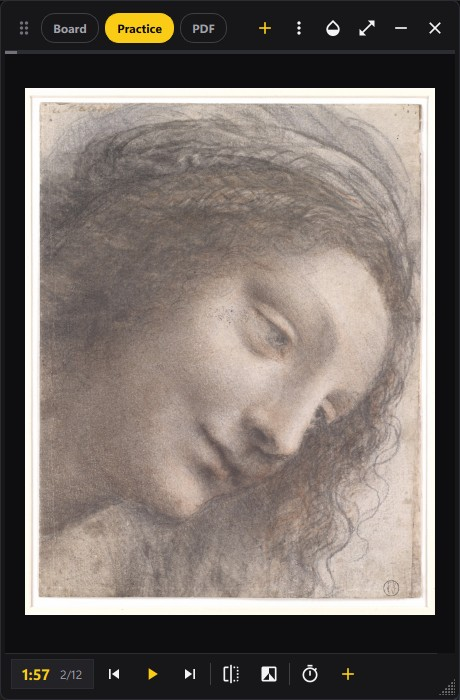
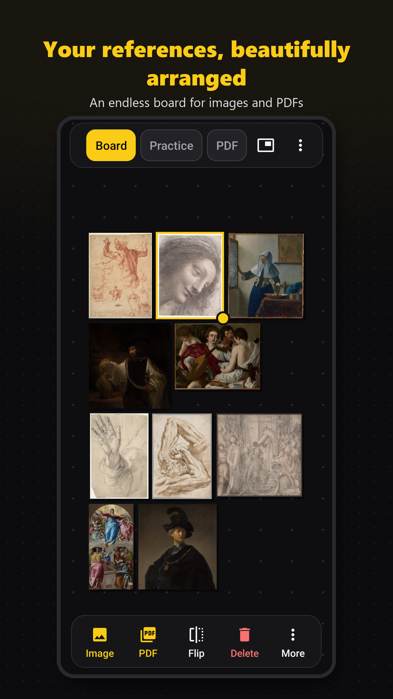
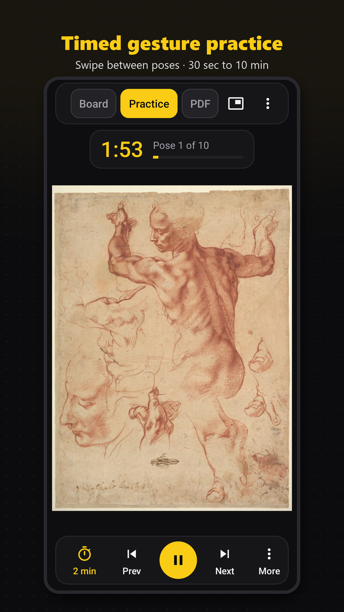
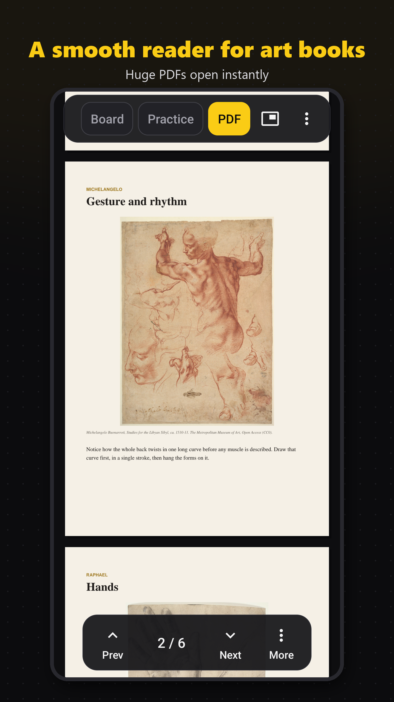

# RefPad: Reference Board

<p align="center">
  
</p>

A free reference companion for artists, for **Windows** and **Android**:

- **Reference board** – an endless board for pictures and PDF pages. Move, resize, flip, rotate, black & white, copy and paste. Saved automatically.
- **Gesture practice** – timed poses from a PDF art book, a folder, or your board images (30 s to 10 min per pose). Pause, skip, flip, black & white, zoom into a pose.
- **PDF reader** – smooth scrolling and sharp zoom; even huge books open instantly because pages render as you scroll. Send a page to the board or practise from it. Remembers where you were.
- **Float on top** – a small window that stays above your drawing app (Clip Studio Paint, Krita, Photoshop, ibisPaint, Infinite Painter…), with adjustable see-through.

Free, no ads, no accounts, no tracking. See the [privacy policy](docs/privacy-policy.html).

## Screenshots

### Windows



| Timed gesture practice | PDF reader |
|---|---|
|  |  |



**Float on top** – press the float button (or `Ctrl+T`) and RefPad becomes a small window that stays above your drawing app. Switch between board, practice and PDF, make it see-through, and drag or resize it wherever it fits. Press the button again to go back to the full window.

<br clear="right">

### Android

<p align="center">
  
  
  
</p>

The pictures shown are public-domain works from The Metropolitan Museum of Art and the Art Institute of Chicago (see [play-store/CREDITS.md](play-store/CREDITS.md)).

---

## Download

### Windows 10 / 11 (64-bit)
Download **`RefPad-Setup-<version>.exe`** from the [latest release](https://github.com/kathir262/REFERENCE-BOARD-/releases/latest) and double-click it.
It installs RefPad for your Windows user (no administrator rights needed) in `%LOCALAPPDATA%\Programs\RefPad`, adds Start menu and desktop shortcuts and an entry in *Settings → Apps*, and lets you double-click `.refpad` board files to open them.

RefPad isn't code-signed yet, so the first time Windows may say "Windows protected your PC": click **More info → Run anyway**.

Prefer no installer? Download `RefPad-<version>-windows-x64.zip`, unzip it and run `RefPad\RefPad.exe` (or `Install RefPad.cmd` inside it).

RefPad updates itself: it checks GitHub at most once a day (you can turn this off in *⋮ → About RefPad*) and offers new versions with an **UPDATE** button. Your board is kept.

### Android
On Google Play (see [play-store/README.md](play-store/README.md) for the publishing guide).

---

## Using RefPad on Windows

| | Mouse | Keyboard |
|---|---|---|
| **Switch mode** | Board / Practice / PDF tabs | `Ctrl+1` `Ctrl+2` `Ctrl+3` |
| **Boards** | click the board name (top left) | `Ctrl+N` new · `Ctrl+O` open · `Ctrl+S` save · `Ctrl+Shift+S` save as |
| **Add pictures, PDFs, folders** | `+` button, or drop files anywhere | `Ctrl+I` pictures, `Ctrl+V` paste (`Ctrl+O` opens a PDF on the Practice and PDF tabs) |
| **Float on top of other apps** | float button in the top bar | `Ctrl+T` |
| **Keep the full window on top** | ⋮ → Keep window on top | `Ctrl+Shift+T` |
| **Full screen** | ⋮ → Full screen | `F11` |

**Board** – scroll to zoom, drag empty space (or middle button, or Space + drag) to move around, drag an image to move it, drag the yellow corner dot to resize, double-click an image to zoom to it, double-click empty space to fit everything, right-click for more.
`H` flip · `G` black & white · `R` / `Shift+R` rotate · `Ctrl+C` copy · `Del` delete (with UNDO) · `Ctrl+A` select all · `Ctrl`-click to select several · `PgUp` / `PgDn` front / back · `F` fit · `Ctrl+Shift+A` arrange in rows.

**Practice** – `Space` play / pause · `←` `→` previous / next (or drag sideways) · `Home` restart the pose · scroll to zoom into a pose, double-click to reset · `H` flip · `G` black & white.

**PDF** – scroll, drag, or use `PgUp` / `PgDn` / `Space` · `Ctrl` + scroll to zoom · double-click or `F` switches between *fit width* and *whole page* · drag the scroll thumb on the right to jump through a long book · right-click a page to send it to the board or practise from it.

**Boards as files** – keep one board per project (say, one per manga chapter). Click the board name at the top left for *New board*, *Open board…*, *Save*, *Save as…* and your recent boards. A `.refpad` file holds the pictures too, so you can move it or copy it to another PC. A board that has a file saves itself when you switch boards or close RefPad; an untitled board asks first. RefPad also opens boards from RefPad 1.0 and BeeRef (`.bee`).

**PDF pages to the board** – choose *Board (choose pages)* when adding a PDF, or right-click a page in the PDF reader. Pick all pages, type page numbers like `1-5, 8, 12-20`, or click page thumbnails. Pages are added one by one; press **STOP** in the message at the bottom to stop early.

The window adapts to any width: when space runs out, tools move into a **More** menu instead of overlapping.

---

## Building from source

### Windows
```bash
py -3.12 -m pip install -r requirements.txt
py -3.12 run.py                      # run from source (or start.bat)
py -3.12 -m pytest tests             # tests
py -3.12 tools/build_windows.py      # build the app and the release zip
```
The build writes to `dist/`:
- `RefPad/` – the app folder (`RefPad.exe` + `_internal/`)
- `RefPad-Setup-<version>.exe` – the one-file installer for first installs
- `RefPad-<version>-windows-x64.zip` and `RefPad-<version>-windows-x64.zip.sha256` – used by the in-app updater

### Android
```bash
cd android
gradlew assembleRelease   # APK for testing
gradlew bundleRelease     # AAB for Google Play
```

---

## Publishing a Windows update

The in-app updater looks at this repository's **GitHub Releases**. It installs a release only if it contains both:
- `RefPad-X.Y.Z-windows-x64.zip`
- `RefPad-X.Y.Z-windows-x64.zip.sha256` (the updater refuses updates without a matching checksum)

and `X.Y.Z` is newer than the installed version. Drafts and pre-releases are ignored.

To ship a new version:
1. Raise `__version__` in `refpad/__init__.py` (for example `1.2.0` → `1.2.1`).
2. Run `py -3.12 tools/build_windows.py`.
3. On GitHub: **Releases → Draft a new release**, tag `v1.2.1` (a new tag each time), add notes (they are shown in the update dialog), and attach the **three** files from `dist/`: the Setup `.exe`, the `.zip` and the `.zip.sha256`.
4. Publish. Installed copies offer the update within a day, or straight away via *⋮ → Check for updates*.

How an update installs: RefPad downloads the zip over HTTPS from GitHub only, checks its size and SHA-256 checksum, unpacks it next to the installed folder, then closes. A small script swaps the folders and restarts RefPad; if the swap fails, the old version is put back. The board and settings live in `%LOCALAPPDATA%\RefPad`, outside the program folder, so updates never touch them. RefPad only updates itself when its folder contains nothing but RefPad's own files.

---

## Project layout

```text
refpad/                 Windows app (Python + Qt / PySide6)
  core/store.py           board, practice list, recent PDFs; autosave
  core/images.py          picture loading, previews, memory-limited cache
  core/pdf.py             PDF pages rendered on demand on a background thread (Qt PDF / PDFium)
  core/importer.py        files, folders, drag and drop, clipboard
  core/timer.py           practice countdown and chime
  core/updater.py         GitHub update check, verified download, folder swap
  ui/window.py            main window and the floating window
  ui/board_view.py        the board
  ui/practice_view.py     practice
  ui/pdf_view.py          PDF reader
  ui/widgets.py           adaptive toolbar, tabs, menus, status chip, empty states
  ui/dialogs.py           About / privacy / update dialogs
tools/                  build script, icon tools, installer scripts
tests/                  automated tests (pytest)
android/                Android app (Kotlin)
docs/privacy-policy.html  privacy policy (Android and Windows)
play-store/             Google Play listing guide and graphics
```

The Windows and Android apps share the same design and icons (`tools/gen_icons.py` copies the Android icons into the Windows app).

## License

MIT License. RefPad for Windows uses Qt for Python (PySide6, LGPL-3.0), which includes Qt PDF (PDFium).
